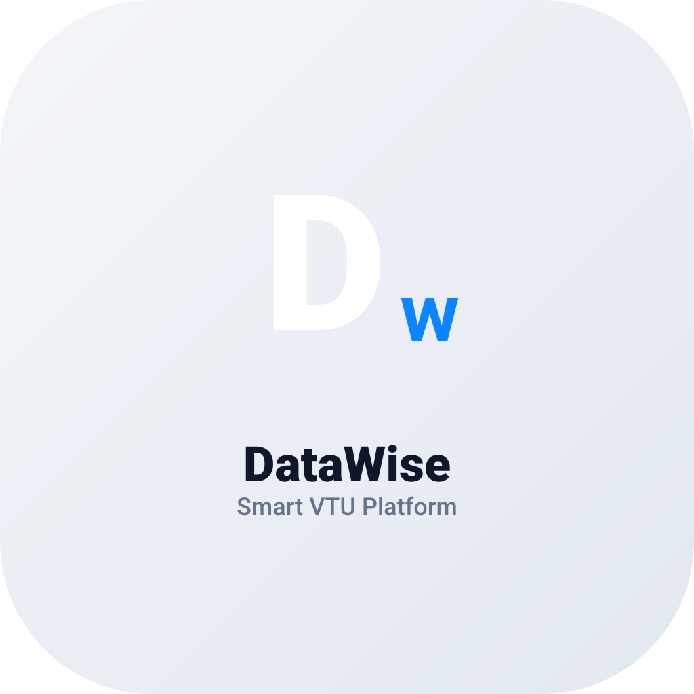
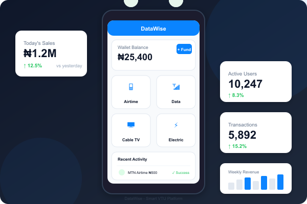

<p align="center">
  
</p>

<h1 align="center">DataWise</h1>

<p align="center">
  VTU &amp; bills-payment mobile app — buy airtime, data, cable TV and electricity from your phone.
</p>

<p align="center">
  
  
  
  
</p>

<p align="center">
  
</p>

## About

DataWise is a mobile front-end for the **DataWise** platform at [datawise.com.ng](https://datawise.com.ng). It gives users a single app for everyday digital purchases:

- 📱 **Airtime top-ups (VTU)** for major Nigerian networks
- 🌐 **Mobile data bundles** — affordable plans for everyday browsing
- 📺 **Cable TV renewals** — DStv, GOtv, StarTimes
- ⚡ **Electricity tokens** — prepaid and postpaid meter top-ups
- 💰 **Wallet balance** — see your account balance and fund it on the website
- 🧾 **Transaction history** — track every purchase from your phone
- 👤 **Account management** — profile, login, registration and password recovery

The app authenticates against the DataWise web API using a token-based session, and stores credentials securely on-device (with optional "remember me").

## Features

| Area | Screens |
| --- | --- |
| Auth | Login, register, password recovery |
| Dashboard | Account balance, quick actions, website link |
| Services | Airtime, data, cable TV, electricity purchase forms |
| Activity | Transaction history |
| Account | Profile & session management |

## Tech stack

- **Expo SDK 54** + **React Native 0.81** (Expo Router v6, file-based navigation)
- **TypeScript 5.9** with typed routes and React Compiler enabled
- **React Navigation** bottom tabs
- **AsyncStorage** for local session/credential storage
- **ESLint** (`eslint-config-expo`) for linting

## Getting started

### Prerequisites

- Node.js 20+
- npm
- Expo Go (or a dev build) to run on a device

### 1. Clone & install

```bash
git clone https://github.com/kingsgc/mbsquare.git
cd mbsquare
npm install
```

### 2. Configure the API endpoint

The backend base URL lives in `lib/config.ts`:

```ts
export const BASE_URL = 'https://datawise.com.ng';
```

Change it to your local/dev server if needed.

### 3. Run the app

```bash
npm start        # Expo dev server (choose platform from the menu)
npm run android  # Android emulator/device
npm run ios      # iOS simulator/device
npm run web      # Browser
npm run lint     # ESLint
```

## Project structure

```
app/                  # Expo Router screens
  (tabs)/             # Bottom tabs: home, services, transactions, account
  auth/               # Login, register, password recovery
  services/           # Airtime, data, cable TV, electricity forms
  api/                # API access screen
components/           # Reusable UI (Screen, Card, Button, Field, ServiceForm, ...)
lib/                  # api.ts (HTTP client), config.ts (base URL), storage.ts (session)
scripts/              # SQL migrations & asset-generation helpers
assets/images/        # Icons, splash, hero image, logo
```

### Database scripts

`scripts/` contains SQL used to provision the backend:

- `add-api-access.sql` — adds `apiAccess` control, `apiusage` and `apitokens` tables
- `rebrand-sitesettings.sql` — rebrands the `sitesettings` row to DataWise
- `delete-all-users.sql` — ⚠️ **irreversible**; wipes all user data (backup first)

## License

Private — all rights reserved.
